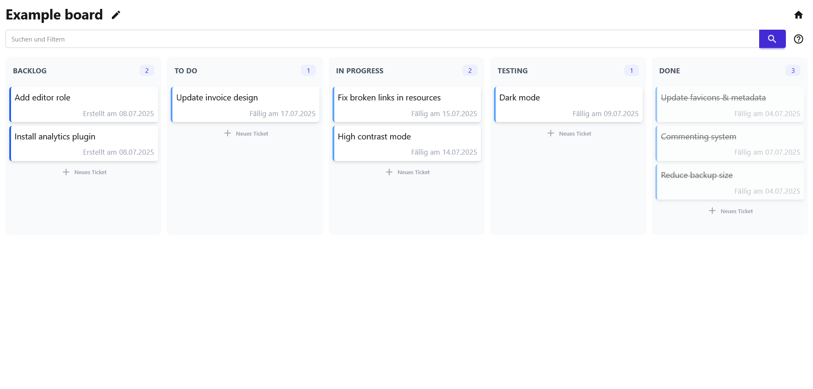

# Boardify

A simple, full-stack Kanban board application built with a Blazor Server frontend and a FastAPI backend. This project serves as a practical example of integrating modern .NET and Python frameworks.



## About The Project

Boardify allows users to manage projects and tasks using a familiar Kanban-style interface. You can create multiple boards, define custom stages (columns) for each board, and manage tickets within them. The frontend is a rich, interactive UI built with Blazor, while the backend provides a robust and high-performance REST API built with FastAPI.

## Features

-   **Board Management**: Create, view, and delete project boards.
-   **Custom Stages**: Define unique stages (e.g., "To-Do", "In Progress", "Done") for each board.
-   **Ticket Management**: Add, view, update, and delete tickets within any stage.
-   **Drag & Drop**: Intuitively move tickets between stages to update their status.
-   **Decoupled Architecture**: A clean separation between the frontend UI and the backend API.

## Tech Stack

The application is built with a modern, decoupled tech stack:

### Backend (Python)

-   **Framework**: [FastAPI](https://fastapi.tiangolo.com/) for creating a high-performance, asynchronous REST API.
-   **Data Validation**: [Pydantic](https://docs.pydantic.dev/) for data validation, serialization, and settings management.
-   **ORM**: [SQLModel](https://sqlmodel.tiangolo.com/) to interact with the database, combining the power of Pydantic and SQLAlchemy.
-   **Database**: SQLite (for simplicity in this example).

### Frontend (C# / .NET)

-   **Framework**: [Blazor Server](https://dotnet.microsoft.com/apps/aspnet/web-apps/blazor) for building an interactive, stateful web UI with C#.
-   **API Communication**: `HttpClient` is used to communicate with the FastAPI backend.
-   **UI**: Component-based architecture using Razor components.

## Getting Started

To get a local copy up and running, follow these simple steps.

### Prerequisites

-   [.NET 6 SDK](https://dotnet.microsoft.com/download) or later
-   [Python 3.8](https://www.python.org/downloads/) or later

### Installation

1.  **Clone the repo**
    ```sh
    git clone https://example.com/your-repo/boardify.git
    ```

2.  **Setup the Backend API**
    ```sh
    # Navigate to the backend directory
    cd boardify/backend

    # Create and activate a virtual environment
    python -m venv venv
    source venv/bin/activate # On Windows use `venv\Scripts\activate`

    # Install dependencies
    pip install -r requirements.txt

    # Run the FastAPI server
    uvicorn main:app --reload
    ```
    The API will be available at `http://127.0.0.1:8000`.

3.  **Setup the Frontend Application**
    ```sh
    # Navigate to the frontend directory
    cd boardify/frontend

    # Restore .NET packages
    dotnet restore

    # Run the Blazor application
    dotnet run
    ```
